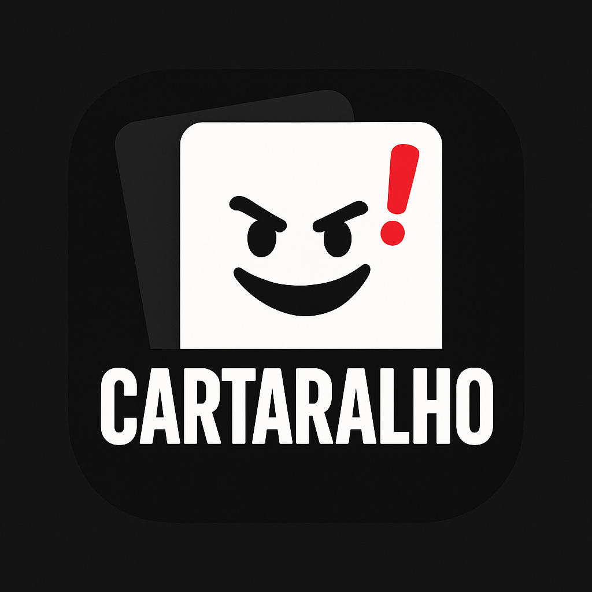
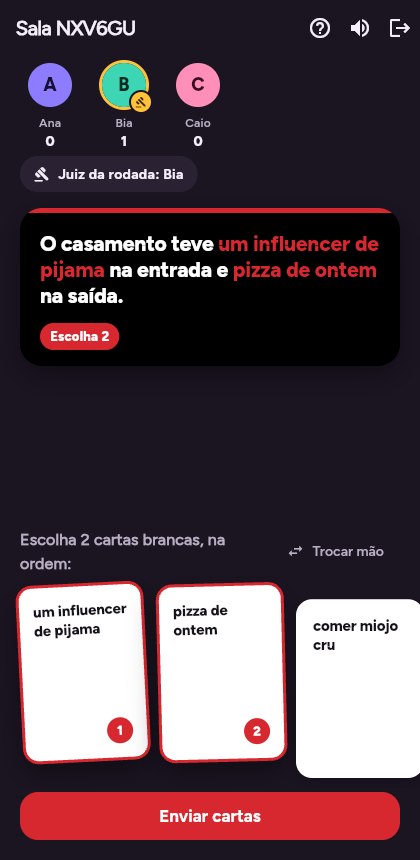
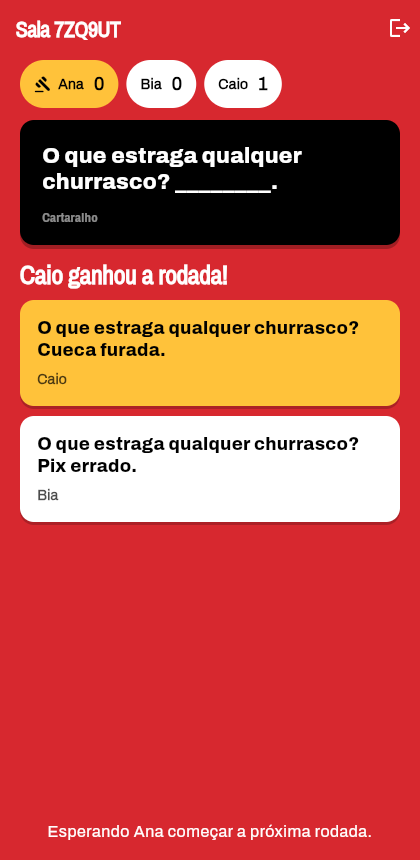
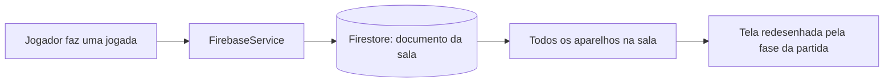

<p align="center"></p>
<h1 align="center">Cartaralho</h1>
<p align="center"><em>O jogo de completar frases absurdas, para jogar com os amigos, cada um no seu celular.</em></p>
<p align="center">
  <a href="https://github.com/pedrinholeda/cartaralho/actions/workflows/ci.yml"></a>
  <a href="LICENSE"></a>
  
</p>

<p align="center">
  
  
</p>

Jogo de cartas de festa precisa de baralho impresso, alguém para embaralhar e uma mesa. E
na hora de contar os pontos, ninguém lembra quem ganhou a rodada passada.

O Cartaralho leva a mesa para o celular. Alguém cria uma sala, os outros entram com o
código, e a cada rodada um juiz lê a carta preta, os outros respondem com a carta branca
mais absurda da mão, e o juiz escolhe a melhor. O app distribui as cartas, conta os pontos e
passa a vez de juiz.

## Como jogar

1. **Criar sala**: quem cria vira o anfitrião, escolhe quantos pontos vencem (3 a 10), quantas
   cartas cada um tem na mão e quais baralhos entram, e recebe um código de seis caracteres.
2. **Entrar**: os outros digitam o código e o nome, ou abrem o convite que o anfitrião
   copiou da sala, que já vem com o código.
3. **Começar**: o anfitrião inicia a partida quando todo mundo entrou (de 3 a 8 jogadores).
4. **Rodada**: o juiz vê a carta preta; cada um dos outros envia uma carta branca; o juiz
   escolhe a combinação mais engraçada e quem a enviou ganha um ponto. Todos veem as cartas
   da mesa e, no fim da rodada, quem enviou cada uma.
5. **Fim**: quem chegar aos pontos combinados primeiro vence. O anfitrião pode jogar de novo
   com o mesmo grupo.

Sem ninguém por perto? **Jogar sozinho contra bots**, na capa: você e 2 a 4 bots, cada um com
o seu gosto (a Tia do Zap adora as cartas do grupo da família; o Coach Quântico, as da
firma). A partida roda no próprio aparelho, sem sala nem código.

## O que faz

**Salas em tempo real**
- Todos na sala veem a mesma coisa ao mesmo tempo, sincronizado pelo Firestore.
- Entrada só com o código e um nome: sem cadastro, o login é anônimo.

**Partida**
- Modo solo contra bots com personalidade, que jogam e julgam pelo próprio gosto.
- Cada jogador ganha uma carinha engraçada, sorteada; na sala de espera dá para sortear outra.
- Fofo por fora, ácido por dentro: ícones com olhinhos, cartas sem dó, e alguns sustos
  escondidos (jogue de madrugada, ou demore para escolher a carta).
- Sete baralhos para misturar: Básico, Brasilidades, Grupo da família, Firma, Rolê,
  Internet e Amor e desamor, com mais de 600 cartas ao todo.
- Lista de jogadores com os pontos e quem é o juiz da vez.
- Cinco cartas brancas na mão, completadas a cada rodada.
- Uma vez por partida, cada jogador pode trocar a mão inteira.
- Sons curtos para cada momento da rodada, com botão de mudo.
- Cartas pretas com duas ou três lacunas pedem duas ou três brancas, na ordem, e a frase
  aparece montada antes de enviar.
- A vez de juiz passa de jogador em jogador, e a rodada só vai para o juiz quando todos
  enviaram a carta.
- As cartas aparecem já encaixadas na frase, numa ordem sorteada para o juiz não saber quem
  jogou o quê, e o resultado da rodada mostra a frase vencedora e quem enviou cada carta.

## Como funciona



Não há servidor próprio: cada sala é um documento no Firestore, e todos os aparelhos
escutam esse documento. Detalhes em [docs/DESENVOLVIMENTO.md](docs/DESENVOLVIMENTO.md).

## Jogar

O jogo está no ar em **https://cartaralho.web.app**. A publicação a cada merge na `main` está
em [docs/FIREBASE.md](docs/FIREBASE.md#publicar-a-web).

## Rodando

Requisitos: [Flutter 3.50](https://docs.flutter.dev/get-started/install) e um projeto
Firebase com login anônimo e Firestore ligados. O repositório já aponta para o projeto do
autor; para usar o seu, siga [docs/FIREBASE.md](docs/FIREBASE.md).

```bash
flutter pub get
```

```bash
flutter run -d chrome
```

Para testar sozinho com três jogadores, veja
[docs/DESENVOLVIMENTO.md](docs/DESENVOLVIMENTO.md#setup-e-o-dia-a-dia).

## Perguntas frequentes

**Preciso criar conta?** Não. O app faz login anônimo sozinho ao abrir.

**As chaves do Firebase no repositório são um vazamento?** Não. Chave de cliente do Firebase
identifica o projeto e vai dentro de qualquer app publicado; quem protege os dados são as
[regras do Firestore](firestore.rules).

**Dá para jogar com cartas minhas?** Ainda não pelo app. As cartas ficam em
[`assets/baralhos/`](assets/baralhos), um arquivo por baralho, e quem roda o projeto pode
editá-las; baralhos próprios dentro do jogo estão no [roadmap](docs/ROADMAP.md).

## Solução de problemas

| o que aparece | causa | o que fazer |
|---|---|---|
| **Erro ao conectar** na tela inicial | o login anônimo falhou | confira se o login anônimo está ativo no Firebase e se `lib/firebase_options.dart` tem a plataforma em uso ([FIREBASE.md](docs/FIREBASE.md#4-conferir)) |
| **Sala não encontrada** | código errado ou sala apagada | confira o código com o anfitrião |
| `flutter test` falha com `Cannot resolve symbolic links` no Windows | caminho com acento | veja as armadilhas no [AGENTS.md](AGENTS.md#armadilhas) |

## Estrutura

```
lib/
  models/      cartas, jogadores e a sala
  services/    tudo que fala com o Firebase
  providers/   estado com Riverpod
  screens/     início, criar, entrar, jogo
  widgets/     peças da tela de jogo
docs/          configuração, desenvolvimento, roadmap
```

O papel de cada arquivo está em [docs/DESENVOLVIMENTO.md](docs/DESENVOLVIMENTO.md#módulos). O visual
(cores, fontes, cartas) está em [docs/DESIGN.md](docs/DESIGN.md).

## Status e roadmap

Em desenvolvimento. Uma partida inteira roda na web, com as regras testadas; o build de
Android e o de iOS ainda precisam de ajuste, e as jogadas ainda não são conferidas pelo
servidor. O que
vem agora está no [roadmap](docs/ROADMAP.md).

## Contribuindo

Setup, o que rodar antes do PR e o formato dos commits estão no
[CONTRIBUTING](CONTRIBUTING.md).

## Licença

[MIT](LICENSE).
