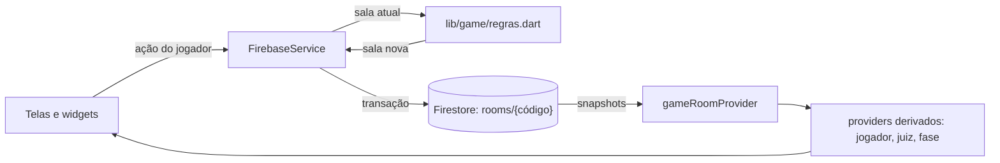

# Desenvolvendo o Cartaralho

Um app Flutter sem servidor próprio: o estado de cada sala é um documento no Firestore, e
todo aparelho na sala escuta esse documento e redesenha a tela quando ele muda.

## Requisitos

- Flutter 3.50 (a versão do CI; outra versão pode mudar o resultado do lint)
- Um projeto Firebase configurado, para rodar o app ([FIREBASE.md](FIREBASE.md)). Lint,
  testes e build não precisam dele.
- Android: Android SDK e um JDK compatível com o Gradle do projeto (ver
  [limites](#limites-conhecidos)). iOS: macOS com Xcode.

## Setup e o dia a dia

```bash
flutter pub get
```

```bash
flutter run -d chrome
```

```bash
flutter analyze
```

```bash
dart format lib test
```

```bash
flutter test
```

Para testar uma partida sozinho, abra três abas do navegador: cada aba faz o próprio login
anônimo e vira um jogador diferente.

### Testes

`test/` cobre o que é código puro: as regras da partida (`test/game/regras_test.dart`:
distribuir as mãos, enviar carta, escolher o vencedor, rodar o juiz, fim de jogo), o
baralho e a conversão dos modelos para o formato do Firestore. Não há teste de tela nem de integração com o Firebase: a tela e a transação se
conferem à mão, numa partida com três jogadores.

## Arquitetura



A tela nunca muda o próprio estado da partida: ela pede ao `FirebaseService`, que lê a sala,
aplica a regra e grava numa transação; a mudança volta para todos pelo stream.

### Módulos

| arquivo | responsabilidade |
|---|---|
| [`lib/main.dart`](../lib/main.dart) | Inicializa o Firebase (com timeout de 30 s) e abre o app dentro do `ProviderScope`. |
| [`lib/firebase_options.dart`](../lib/firebase_options.dart) | Opções do Firebase por plataforma, geradas pelo FlutterFire CLI. |
| [`lib/models/`](../lib/models) | `GameCard`, `Player` e `GameRoom`, imutáveis, com `fromJson`/`toJson`/`copyWith`. `GamePhase` lista as fases da partida. |
| [`lib/game/regras.dart`](../lib/game/regras.dart) | As regras como funções puras: `iniciarJogo`, `enviarCarta`, `escolherVencedor`. Recebem a sala e devolvem a sala nova, ou lançam `JogadaInvalida`. |
| [`lib/game/baralho.dart`](../lib/game/baralho.dart) | O baralho com que toda sala começa (15 pretas, 48 brancas, até 8 jogadores). |
| [`lib/services/firebase_service.dart`](../lib/services/firebase_service.dart) | Login anônimo, criar e entrar em sala e o stream da sala. As jogadas passam por `_alterarSala`, que roda a regra numa transação. |
| [`lib/providers/auth_provider.dart`](../lib/providers/auth_provider.dart) | Stream do usuário logado. |
| [`lib/providers/game_provider.dart`](../lib/providers/game_provider.dart) | Código da sala atual, stream da sala e o que deriva dela: jogador atual, se é anfitrião, se é juiz, fase. |
| [`lib/screens/home_screen.dart`](../lib/screens/home_screen.dart) | Faz o login anônimo (três tentativas) e mostra criar/entrar; com uma sala escolhida, mostra a `GameScreen`. |
| [`lib/screens/game_screen.dart`](../lib/screens/game_screen.dart) | Escolhe o que mostrar pela fase da partida. |
| [`lib/widgets/`](../lib/widgets) | Lista de jogadores com pontos, carta preta, mão de cartas brancas, escolha do juiz. |

### Decisões que não são óbvias

- **Sem backend.** A regra do jogo roda no aparelho de quem faz a jogada e grava direto no
  documento da sala. É simples e barato, mas o servidor não impede trapaça (ver o roadmap).
- **Regra pura, gravada em transação.** Dois jogadores enviam carta quase ao mesmo tempo; a
  transação do Firestore repete a regra com a sala atualizada e nenhuma jogada se perde. A
  regra não sabe de Firebase, então é testada sem ele.
- **Uma sala, um documento, inclusive as mãos.** É o jeito mais simples de todo mundo ver o
  mesmo estado, mas qualquer jogador consegue ler a mão dos outros pelo Firestore (ver o
  roadmap).
- **As cartas jogadas voltam ao fim do monte.** Assim o baralho não acaba em partidas
  longas; uma carta pode reaparecer depois de o monte dar a volta.
- **Login anônimo.** Ninguém cria conta para jogar; o `uid` anônimo identifica o jogador
  na sala. Sair do app com logout gera outro `uid`, ou seja, outro jogador.
- **Navegação pela sala, não por rota.** A `HomeScreen` mostra a `GameScreen` quando
  `roomIdProvider` tem valor; limpar o provider volta ao início.

### Limites conhecidos

Os principais, todos com item no [roadmap](ROADMAP.md):

- Na web, `DefaultFirebaseOptions` não tem opções e o login falha; no iOS e no macOS as
  opções são de exemplo, de outro projeto.
- O projeto iOS não tem `Runner.xcodeproj`, então não compila.
- O build Android usa o formato antigo do plugin do Flutter e o Gradle 8.10, que não roda
  com JDK 25.

## Releases

O [release-please](https://github.com/googleapis/release-please) lê os Conventional
Commits da `main` e mantém um PR de release com o `CHANGELOG.md` e a versão nova no
`pubspec.yaml`. O merge desse PR cria a tag `vX.Y.Z` e a Release no GitHub. Ainda não há
build de Android, iOS ou web na tag nem publicação em loja.
