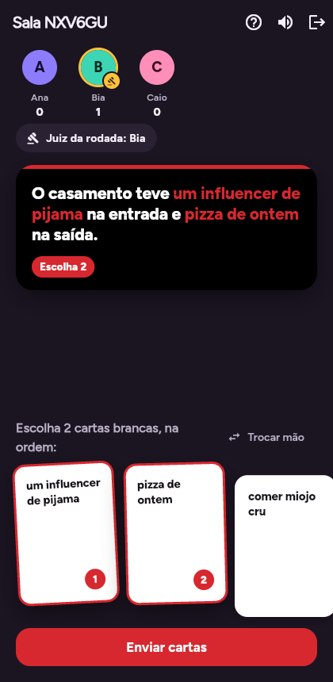
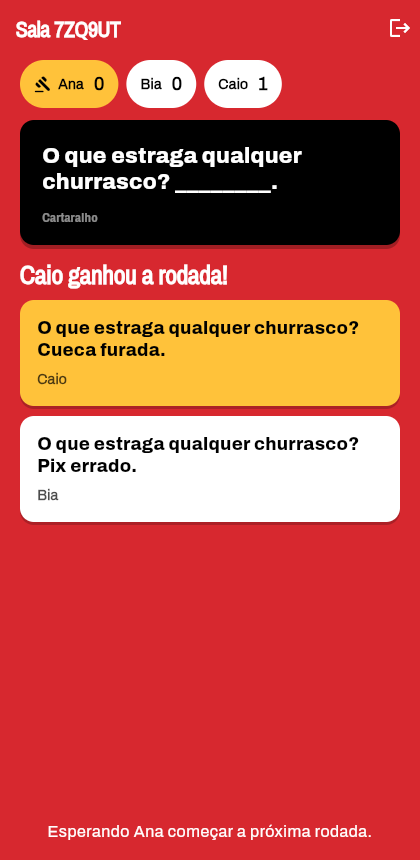
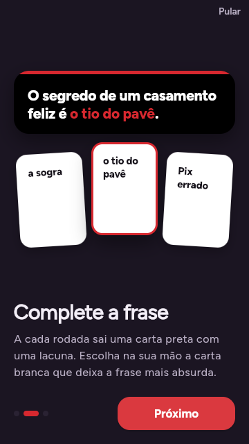
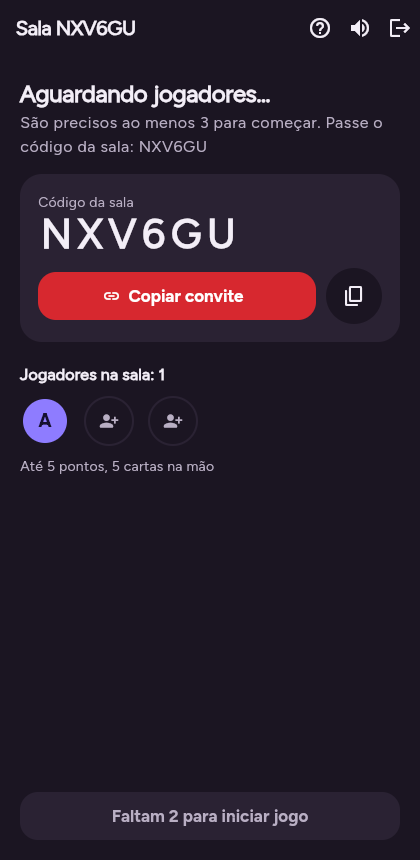
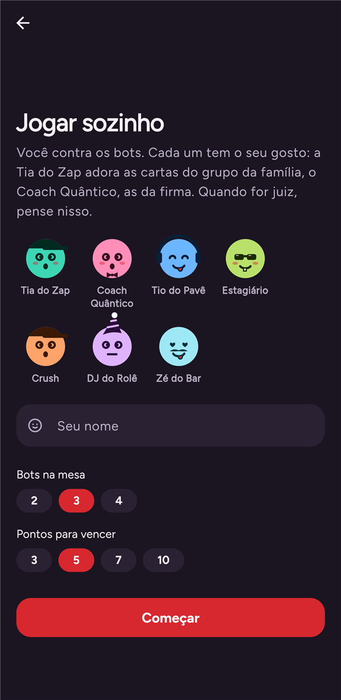
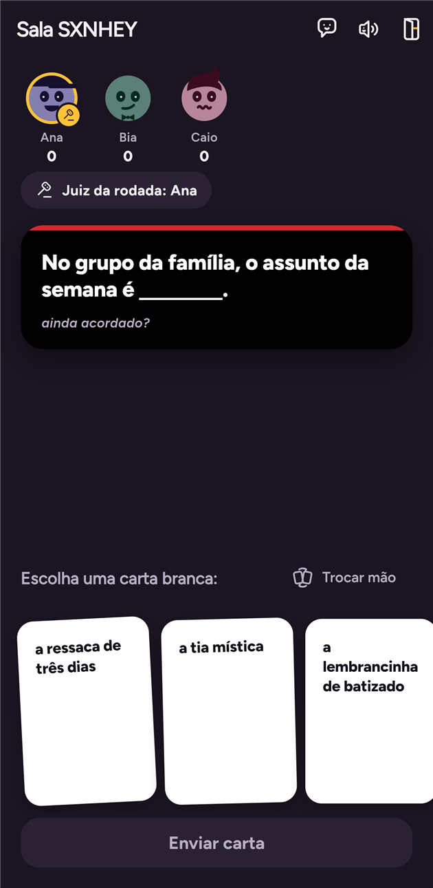
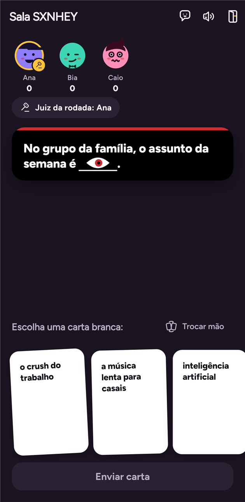
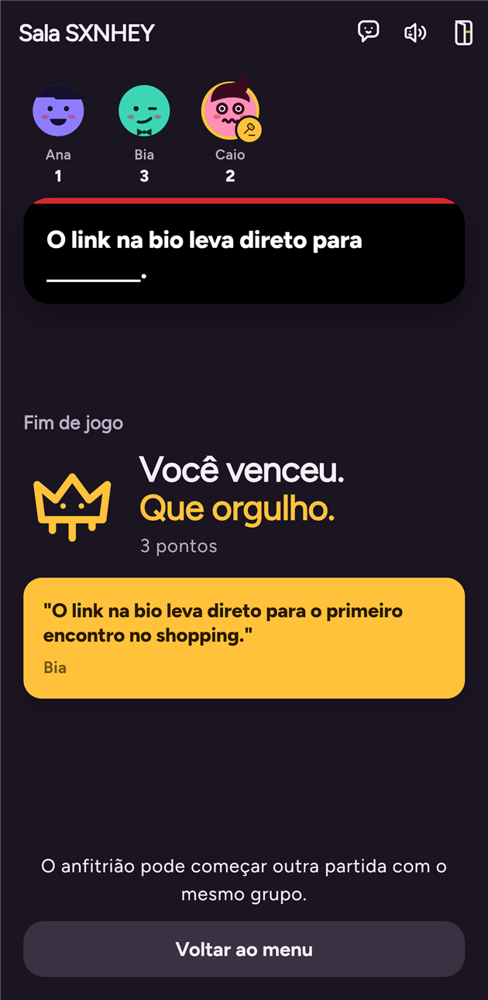

# Design do Cartaralho

**Noite de jogo.** O jogo acontece numa mesa escura, como uma sala com a luz baixa no fim
da festa. As cartas brilham em cima dela; o vermelho do logo aparece só onde há uma ação a
fazer; o amarelo marca o juiz e quem ganhou. Tudo é arredondado, macio e responde ao toque.

**Fofo por fora, ácido por dentro.** A interface é redonda, gordinha e sorridente: as
carinhas dos jogadores e os ícones têm olhinhos. As cartas dizem as piores coisas. E de vez
em quando, algo na mesa olha de volta.

  
  
  

## Logo

[`marca/logo-carta-escura.png`](marca/logo-carta-escura.png): a carta branca com cara de
malandra e o ponto de exclamação vermelho, sobre fundo preto. As outras duas propostas
ficam em `marca/` como registro. Os ícones do app (web e Android) saem dele com
`dart run flutter_launcher_icons`, configurado no `pubspec.yaml`; trocou o logo, rode de novo.

## Princípios

- **A carta é a estrela.** A mesa escura some e as cartas aparecem. Texto longo vai numa
  carta; na mesa ficam só títulos curtos, avisos e o placar.
- **Vermelho é ação.** O botão que faz o jogo andar, a carta escolhida e a resposta montada
  na frase. Se algo é vermelho, dá para tocar ou foi você que escolheu.
- **Amarelo quer dizer "é você" ou "ganhou".** O juiz da rodada e a carta vencedora.
- **Sempre dá para saber de quem é a vez.** Um aviso curto embaixo do placar diz quem julga
  e o que fazer agora.
- **A frase pronta antes de enviar.** Enquanto o jogador escolhe, a resposta aparece em
  vermelho dentro da carta preta.
- **Tudo tem carinha, menos a carta.** Ícones e avatares sorriem; o texto da carta preta e
  das brancas continua seco e afiado. O fofo nunca entra na frase.
- **O creepy é raro.** Três sustos pequenos, em momentos certos (abaixo). Nunca no meio da
  jogada, nunca escondendo um botão.
- **Movimento mostra o que mudou.** A carta escolhida sobe; as cartas novas entram na mão uma
  a uma; as respostas viram para o juiz; a fase nova entra com um fade curto; quem ganha leva
  confete; o botão encolhe um pouco ao ser apertado. Nada se mexe sem motivo, e com "reduzir
  movimento" ligado no sistema tudo aparece direto.

## Cores

Em [`lib/ui/tema.dart`](../lib/ui/tema.dart), na extensão `Cores` (`Cores.noite`). Widget
nenhum usa cor em hexadecimal: pede `Cores.de(context)`. O tema é um só, escuro: a noite é a
identidade do jogo, não uma preferência do sistema.

| token | cor | uso |
|---|---|---|
| `mesa` | `#1B1522` | fundo de todas as telas |
| `superficie` | `#2A2233` | um degrau acima: painéis, avisos, campos, botão secundário |
| `tintaNaMesa` | `#F3EEF7` | texto e ícones sobre a mesa |
| `tintaSuave` | `#B9AFC4` | texto de apoio: legendas, dicas, nomes no placar |
| `carta` | `#FFFFFF` | carta branca |
| `tintaNaCarta` | `#16121A` | texto da carta branca |
| `cartaPreta` | `#000000` | carta preta |
| `tintaNaCartaPreta` | `#FFFFFF` | texto da carta preta |
| `acao` | `#D7282F` | botão principal, carta escolhida, resposta na frase (o vermelho do logo) |
| `tintaNaAcao` | `#FFFFFF` | texto no botão principal |
| `destaque` | `#FFC23A` | juiz da rodada, carta vencedora, foco do teclado |
| `tintaNoDestaque` | `#2B1A00` | texto sobre o amarelo |

Cada jogador tem uma cor fixa no avatar, pela posição na sala (`coresDeJogador`): oito tons
que aparecem bem na mesa escura e não se confundem com o vermelho da ação nem com o amarelo
do juiz. [`test/ui/contraste_test.dart`](../test/ui/contraste_test.dart) confere que todo par
de texto passa de 4,5:1 (WCAG AA), que bordas e foco passam de 3:1 e que os traços de cada
carinha se leem sobre a cor do avatar. Foi esse teste que trocou o vermelho mais claro da proposta
(`#E5484D`, 3,9:1 com texto branco) pelo vermelho do logo.

Medidas em `Medidas`: espaço de 8, margem de 20, raio de carta 16, de painel 22 e de botão
18, largura máxima do conteúdo 560.

## Dicas da primeira partida

[`lib/ui/dicas.dart`](../lib/ui/dicas.dart): `BalaoDeDica`, um balão amarelo (a cor de "é
você") com uma setinha para o que ele aponta e o "Entendi" para fechar; pula de leve, menos
com "reduzir movimento". Três dicas, cada uma uma vez por aparelho (`shared_preferences`):

| dica | onde | some quando |
|---|---|---|
| mão | acima da mão, antes de escolher | toca numa carta |
| enviar | acima do botão, com a carta escolhida | envia |
| juiz | acima das frases, na hora de julgar | toca numa frase |

O balão entra no fluxo da tela (não cobre carta nem botão) e é lido pelo leitor de tela.

## Ícones

[`lib/ui/icones.dart`](../lib/ui/icones.dart): `IconeFofo(Desenho.xxx)` desenha os ícones
do jogo no traço das carinhas (grosso, ponta redonda) e funciona onde caberia um `Icon`:
sem cor, pega a do `IconTheme`. Nada de `Icons.xxx` do Material em tela nova.

| desenho | onde | o detalhe |
|---|---|---|
| `ajuda` | "Como jogar" e "?" | um balão que sorri |
| `som`, `mudo` | botão de som | o alto-falante tem cara; mudo, ele dorme |
| `sair` | sair da sala | alguém espia pela fresta da porta, com olhos amarelos |
| `trocar` | trocar mão | duas cartas girando |
| `juiz` | aviso e selo do juiz | o martelo tem olhinhos |
| `dado` | sortear outra carinha | um dado sorrindo |
| `convite`, `copiar` | sala de espera | envelope com coração; a folha copiada também olha |
| `coroa` | fim de jogo | derrete: `gotejo` vai de 0 a 1 |
| `pessoa`, `chave` | campos de nome e código | uma carinha; a chave tem um olho |

## Tipografia

**Figtree** em tudo, pelo pacote `google_fonts`: arredondada e amigável. 800 nos títulos e
no texto das cartas, 700 nos botões, 400 a 600 no resto. Os rótulos de botão vão em frase
normal ("Criar sala", "Enviar carta"), nunca em Caixa De Título.

## Componentes

[`lib/ui/cartas.dart`](../lib/ui/cartas.dart):

- `CartaPreta`: a frase da rodada, com a faixa vermelha no topo. Recebe `respostas`, que
  aparecem em vermelho no lugar das lacunas; a carta que pede mais de uma branca mostra
  "Escolha 2".
- `CartaBranca`: carta da mão (proporção de baralho; sobe e ganha contorno vermelho quando
  escolhida; mostra a ordem quando a preta pede mais de uma) ou carta larga com a frase
  inteira (mesa, juiz, resultado; com o nome de quem enviou e em amarelo quando venceu).
  A carta em branco aparece com o convite "carta em branco: toque para escrever", apagado e
  em itálico; ao tocar, um diálogo pede a resposta, que entra na frase como qualquer carta.
  Inclina em 3D seguindo o mouse (no celular, o dedo enquanto está em cima): bem na mão, de
  leve nas largas. Ao enviar, as escolhidas voam em arco até a carta preta, girando,
  encolhendo e sumindo (`voarCartas`, numa camada por cima de tudo).
  Funciona pelo toque, pelo mouse e pelo teclado (Tab, Enter ou Espaço), com contorno
  amarelo de foco.
- `MaoEmLeque`: a mão numa faixa horizontal que se arrasta para os lados, com as cartas
  levemente inclinadas.

[`lib/ui/jogadores.dart`](../lib/ui/jogadores.dart):

- `AvatarDeJogador`: a carinha do jogador num círculo da cor dele; o juiz ganha anel
  amarelo e martelo.

[`lib/ui/carinhas.dart`](../lib/ui/carinhas.dart): cada jogador tem uma carinha, desenhada
pelo próprio jogo, sem imagem nem biblioteca. São oito olhos (pontos, sono, feliz, vesgo,
arregalados, piscando, apaixonado, malandro), oito bocas (sorriso, risada, susto, língua de
fora, reta, enjoada, dentuça, de lado), oito enfeites (nada, óculos escuros, boné, chapéu de
festa, bigode, fone, topete, gravata-borboleta) e bochechas ou não: 1.024 carinhas. Os
traços vão na tinta do jogador, e só a língua e as bochechas pegam o vermelho. A carinha sai
do id do jogador e de quantas vezes ele pediu outra (`Player.avatar`), então é a mesma em
todos os aparelhos; na sala de espera, tocar na própria carinha ou em "Sortear outra
carinha" troca, com um pulinho. Chapéu, topete, fone e aba do boné saem do círculo, e quem
mostra o avatar deixa espaço em cima.
- `AvisoDaVez`: a pílula de "Juiz da rodada: Ana" ou "Sua vez de julgar".

**Carinhas vivas** ([`lib/ui/olhar.dart`](../lib/ui/olhar.dart)): todo avatar flutua num
ritmo que sai da semente (cada um no seu), pisca de vez em quando e olha para o ponteiro, que
`RastreadorDeOlhar`, em volta do app, anota (o mouse no computador, o último toque no
celular). Dentro de um `GrupoDeCarinhas` (placar, sala de espera, capa), de 18 a 35 segundos
uma carinha vai até a vizinha, dá um cascudo e volta; a vizinha é empurrada, balança e fica
tonta (olhos em X e uma estrelinha). Na sala de espera, o cascudo não atravessa a quebra de
linha. Com "reduzir movimento", tudo fica parado.

**Reações rápidas** ([`reacoes_widget.dart`](../lib/widgets/reacoes_widget.dart)): tocar na
própria carinha no placar abre, embaixo, cinco reações desenhadas no traço dos ícones:
risada (amarela), choro, caveira ("Morri"), coração (vermelho) e chocado. A escolhida sobe da
carinha e some em 1,8 s, na tela de todo mundo. Só a reação nova sobe; a que já estava quando
a tela abriu, não.

**Carinhas que reagem** (`Humor`, calculado por `humorNoPlacar` no placar):

| fase | quem | carinha |
|---|---|---|
| escolhendo | quem ainda não enviou | balão de "…" e olhos para o lado, pensando |
| escolhendo, juiz decidindo | quem já enviou | uma cartinha branca na mão |
| escolhendo, juiz decidindo | o juiz | olhos para cima |
| juiz decidindo há mais de 20 s | os outros | treme e solta um "!" amarelo |
| resultado, fim | quem ganhou | pulinhos |

Quem lidera sozinho a partida (`liderDaSala`) usa a coroa derretendo em cima da cabeça.

[`lib/ui/animacoes.dart`](../lib/ui/animacoes.dart):

- `Entrada`: a carta sobe e aparece, uma vez, na primeira vez que é montada (uma `key` por
  carta faz só as novas animarem).
- `Virada`: a carta começa de costas (verso preto com borda da cor da mesa) e vira.
- `Confete`: papéis amarelos, brancos e vermelhos caindo por cima da tela, sem capturar
  toque.
- `movimentoReduzido(context)`: verdadeiro quando o sistema pede menos movimento; os três
  componentes já respeitam.

## Telas

| tela | o que tem |
|---|---|
| Capa | "Como jogar" e som em cima; a carta preta e a branca que formam o nome do jogo, com três carinhas espiando entre elas; "Carinhas fofas. Cartas horríveis."; "Criar sala" e "Entrar na sala" embaixo |
| Jogar sozinho ([`solo_screen.dart`](../lib/screens/solo_screen.dart)) | os sete bots com carinha e nome, para conhecer a mesa; nome, quantos bots (2 a 4), pontos e os baralhos (a mesma lista de "Criar sala"); "Começar" abre a partida já com você de juiz, e o título vira "Jogo solo" |
| Tutorial ([`tutorial_screen.dart`](../lib/screens/tutorial_screen.dart)) | três telas (chame a galera, complete a frase, o juiz escolhe) com as cartas de verdade num exemplo; abre sozinho na primeira visita e pelo "Como jogar" ou pelo "?" |
| Sala de espera | código num painel com "Copiar convite" e copiar código; "Chama a galera" e quantas pessoas faltam ("a mesa já está com fome"); a carinha e o nome de quem entrou, "Sortear outra carinha" e os lugares vazios com olhinhos no escuro; o botão diz quantos faltam |
| Jogo | placar de avatares; aviso de quem é a vez; carta preta com a frase montada; mão em leque e botão fixo embaixo |
| Juiz e mesa | as frases viram uma a uma; o juiz toca e confirma |
| Resultado | a frase vencedora em amarelo, com confete, e o que cada um jogou; no fim de jogo, a coroa que derrete |

Em tela larga (900 px ou mais) o jogo vira duas colunas. À esquerda, numa coluna de 420 px
que rola: o placar em lista (uma linha por jogador, com o nome inteiro e os pontos), o aviso
de quem é a vez e a carta preta com letra maior (27 em vez de 21). À direita, a jogada; a mão
usa cartas de 168 px quando tem 640 px ou mais de largura.

## Momentos creepy

Em [`lib/ui/assombro.dart`](../lib/ui/assombro.dart), com a hora vinda de `agora()` para os
testes fixarem.

- **Madrugada** (das 3h às 4h59, `ehMadrugada`): as carinhas desbotam e ficam de olhos
  fundos, cada uma olhando um pouco para um lado; a carta preta ganha o rodapé "ainda
  acordado?". A carinha desbotada ainda passa de 3:1 com os traços (teste de contraste).
- **A lacuna espera**: quem ainda não enviou e passa de `esperaDaLacuna` (40 s) olhando a
  carta vê a primeira lacuna vazia abrir um olho de pupila vermelha, que olha de um lado
  para o outro. Fecha quando a carta é enviada ou a rodada muda; com a lacuna preenchida
  não há onde abrir.
- **A coroa derrete**: no fim de jogo a coroa sorri e pinga devagar. Quem venceu lê "Você
  venceu. Que orgulho."; os outros, "Bia venceu. Que pena."
- **O lugar vazio** da sala de espera é um buraco escuro com dois olhinhos amarelos que
  piscam de vez em quando.

Com "reduzir movimento", o olho já vem aberto e parado, a coroa já vem derretida e os
olhinhos não piscam.

  
  
  

## Som

Cinco efeitos curtos, em `assets/sons/`, gerados por [`tool/gerar_sons.mjs`](../tool/gerar_sons.mjs)
(síntese própria: nenhum arquivo de terceiros, nenhuma licença a conferir):

| som | quando | como soa |
|---|---|---|
| `distribuir` | cartas novas na mão | quatro estalos de carta |
| `enviar` | o jogador enviou | um sopro e um estalo |
| `virar` | as respostas viram para o juiz | dois estalos |
| `rodada` | saiu o resultado da rodada | três notas subindo (dó, mi, sol) |
| `vitoria` | alguém venceu o jogo | fanfarra curta terminando num acorde |

Cada som tem um volume combinado (média da parte que soa): os que tocam toda hora são mais
discretos, a vitória é a mais alta. O pico nunca passa de -1 dBFS e todo som começa e termina
no zero, para não estalar. `node tool/medir_sons.mjs` mede, e
[`test/ui/sons_arquivos_test.dart`](../test/ui/sons_arquivos_test.dart) confere.

| som | volume |
|---|---|
| `distribuir`, `enviar`, `virar` | -16 dBFS |
| `rodada` | -14 dBFS |
| `vitoria` | -11 dBFS |

O botão de som fica na capa e na barra de cima da tela de jogo; a escolha é lembrada entre
partidas (`shared_preferences`, localStorage na web). Na web o navegador só deixa tocar
depois do primeiro toque na página, e todo som vem depois de "Criar sala" ou "Entrar na
sala". Se o navegador recusar, o jogo segue em silêncio. No celular, escolher e enviar
carta também vibram de leve.

## Decisões

- **Por que escuro.** As cartas são brancas e pretas; numa mesa escura elas são o que mais
  aparece, e o logo já é uma carta sobre fundo preto. A mesa vermelha das versões 0.4 e 0.5
  cansava a vista e deixava o amarelo do juiz berrante.
- **Por que um tema só.** Um tema claro precisaria de outra paleta inteira e outra revisão
  de contraste para pouco ganho; a noite é a identidade.
- **Por que não preto e branco com Helvetica.** É o visual de outro jogo de cartas muito
  conhecido; o Cartaralho precisa ser reconhecido como ele mesmo.
- **A mão em leque, não em grade.** Na grade cada carta ocupava meia tela e era quase toda
  espaço vazio; no leque cabem mais cartas, o polegar arrasta, e a carta preta continua à
  vista em cima.
- **Brancas em minúscula.** O texto da carta branca vai para o meio da frase; o jogo põe a
  maiúscula quando ela abre a frase (`fraseCompleta`).
