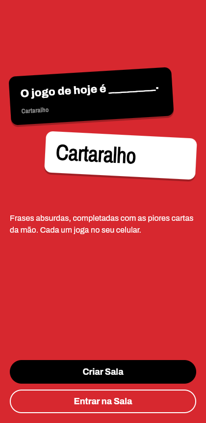
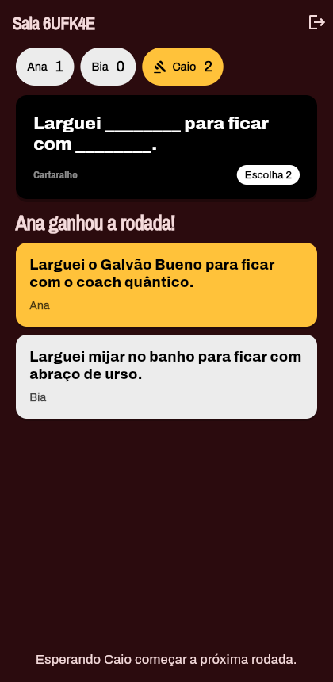

# Design do Cartaralho

O jogo acontece numa mesa. Tudo que se lê fica numa carta: a carta preta com a frase, as
brancas com as respostas. A mesa é vermelha, a cor dos três logos em [`marca/`](marca), e é
o único lugar onde o visual ousa; o resto fica quieto para as frases aparecerem.

  
  
  

## Logo

[`marca/logo-carta-escura.png`](marca/logo-carta-escura.png): a carta branca com cara de
malandra e o ponto de exclamação vermelho, sobre fundo preto. As outras duas propostas
ficam em `marca/` como registro. Os ícones do app (web e Android) saem dele com
`dart run flutter_launcher_icons`, configurado no `pubspec.yaml`; trocou o logo, rode de novo.

## Princípios

- **Carta é para ler, mesa é para estar.** Texto longo nunca fica direto na mesa: vai numa
  carta. Na mesa só ficam títulos curtos e avisos.
- **Uma ousadia só.** A mesa vermelha de ponta a ponta. Cartas, botões e placar ficam em
  preto, branco e, raramente, amarelo.
- **Amarelo quer dizer "é você" ou "ganhou".** Só o juiz da rodada e a carta vencedora usam
  o amarelo do confete. Nada mais.
- **Carta tem cara de carta.** Proporção de baralho (63 × 88 mm) na mão, cantos de 14 px,
  sombra seca embaixo, como papel cartão em cima da mesa. Botão é redondo para não ser
  confundido com carta.
- **Movimento responde ao jogador.** A carta escolhida sobe; nada se mexe sozinho. Com
  "reduzir movimento" ligado no sistema, nem isso.

## Tokens

Em [`lib/ui/tema.dart`](../lib/ui/tema.dart), na extensão `Cores` do tema. Widget nenhum usa
cor em hexadecimal: pede `Cores.de(context)`.

| token | claro | escuro | uso |
|---|---|---|---|
| `mesa` | `#D7282F` | `#2B0B0E` | fundo de todas as telas |
| `tintaNaMesa` | `#FFFFFF` | `#F4DADB` | texto e ícones sobre a mesa |
| `carta` | `#FFFFFF` | `#ECECEC` | carta branca, campos de texto, ficha do placar |
| `tintaNaCarta` | `#000000` | `#000000` | texto da carta branca |
| `cartaPreta` | `#000000` | `#000000` | carta preta, botão principal, contorno da carta escolhida |
| `tintaNaCartaPreta` | `#FFFFFF` | `#FFFFFF` | texto da carta preta e do botão |
| `destaque` | `#FFC23A` | `#FFC23A` | juiz da rodada, carta vencedora |

No tema escuro a mesa vira vinho e a carta branca perde um pouco de brilho, para não
ofuscar numa sala escura; a carta preta continua preta.

Medidas em `Medidas`: espaço de 8, margem de 20, raio de carta 14, raio de botão 28,
largura máxima do conteúdo 560 (em tela larga o jogo fica centralizado).

## Tipografia

- **Archivo Narrow 700** nos títulos e no nome do jogo: estreita e pesada como as letras
  dos logos.
- **Archivo 800** no texto das cartas; **Archivo** normal no resto.

As fontes vêm do Google Fonts pelo pacote `google_fonts`, baixadas no primeiro uso. O jogo
já precisa de internet para falar com o Firebase, então isso não cria uma dependência nova.

## Componentes

[`lib/ui/cartas.dart`](../lib/ui/cartas.dart):

- `CartaPreta`: a frase da rodada. A lacuna `____` vira uma linha longa; a carta que pede
  mais de uma branca mostra "Escolha 2".
- `CartaBranca`: carta da mão (proporção de baralho; sobe e ganha contorno preto quando
  escolhida; mostra a ordem quando a preta pede mais de uma) ou carta larga com a frase
  inteira (mesa, juiz, resultado; com o nome de quem enviou e em amarelo quando venceu).
- `GradeDeCartas`: a mão, com quantas cartas couberem lado a lado (duas no celular).

## Decisões

- **Por que não preto e branco com Helvetica.** É o visual de outro jogo de cartas muito
  conhecido; o Cartaralho precisa ser reconhecido como ele mesmo. A mesa vermelha e a
  Archivo fazem isso.
- **Por que não feltro verde.** É mesa de cassino, não de festa em casa.
- **Sombra seca, sem desfoque.** Lembra papel em cima de mesa e não o cartão flutuante
  genérico de app.
- **Brancas em minúscula.** O texto da carta branca vai para o meio da frase; o jogo põe a
  maiúscula quando ela abre a frase (`fraseCompleta`).

## Pendências

No [roadmap](ROADMAP.md), fase 3: animações,
efeitos sonoros, sala de espera com compartilhamento e layout próprio para tela larga.
